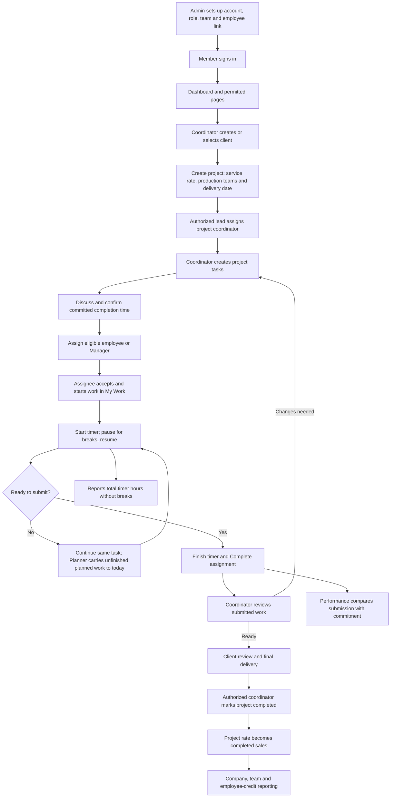
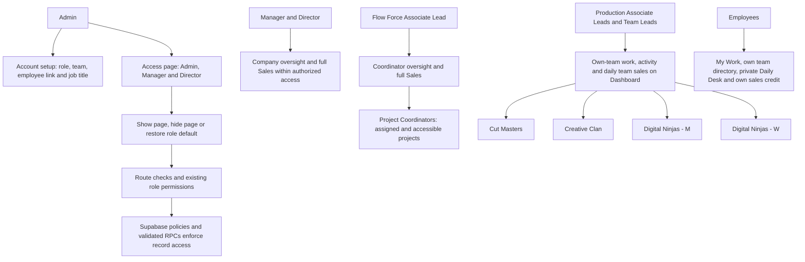
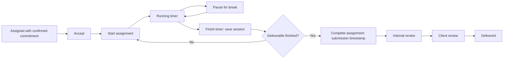
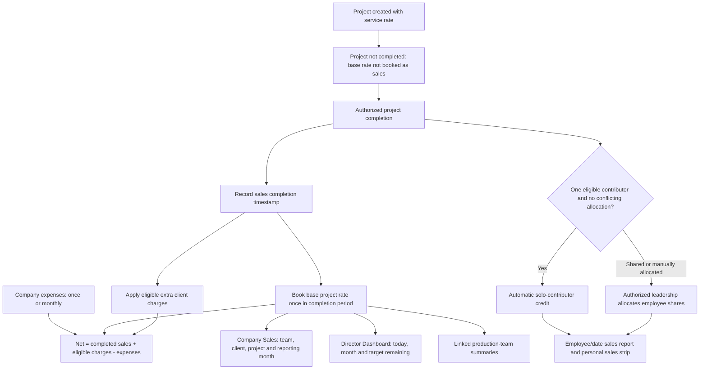
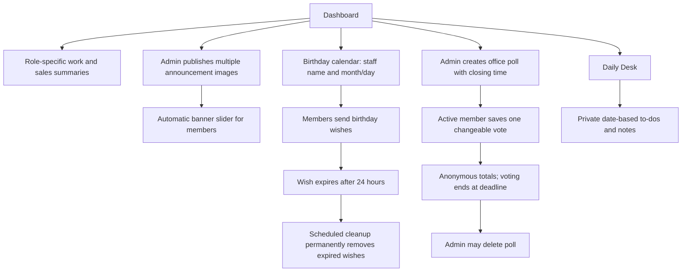
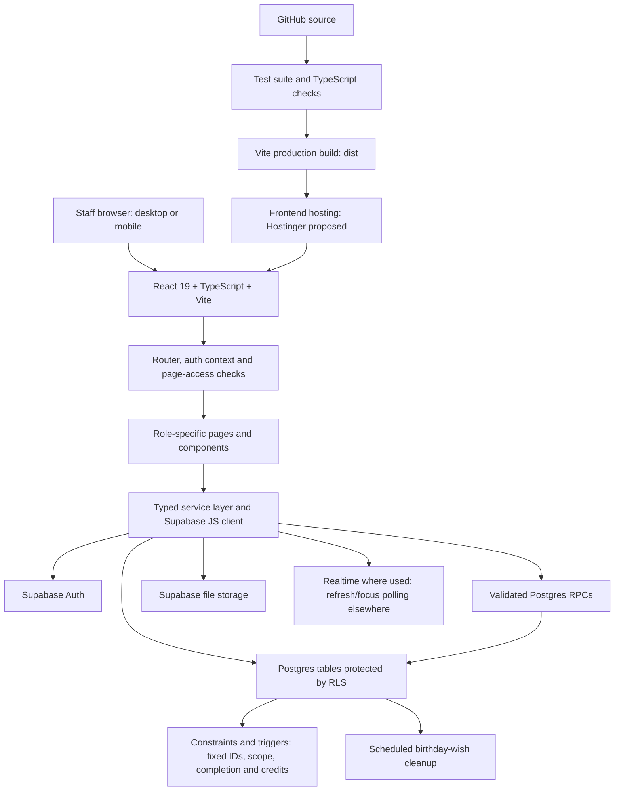
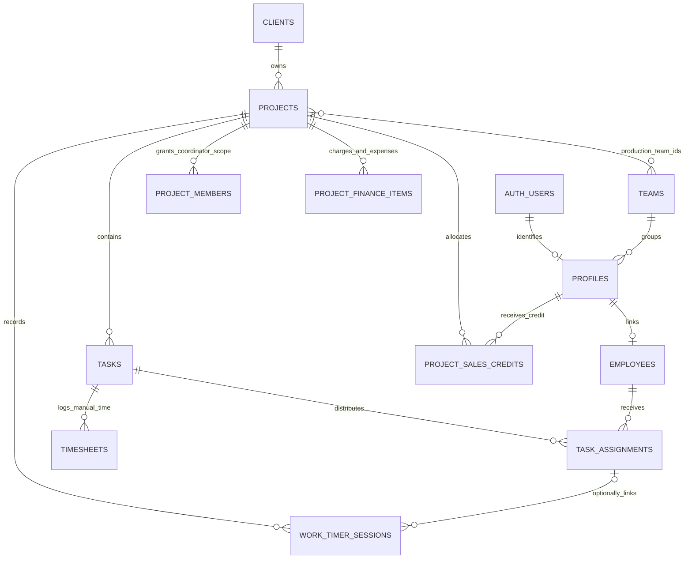

# Internal Force — Project workflow reference

For staff, coordinators, team leads, management and developers. Prepared **14 October 2026** from the current application and Supabase migrations. All working days, deadlines and sales reporting dates use **India Standard Time (IST)**.

This reference describes implemented workflows. Actual access depends on the signed-in account, active status, team, project scope and saved page rules. **Hostinger is a proposed hosting destination; this document does not mean deployment has occurred.**

## 1. Complete business workflow

**The three completion events are separate:** finishing a timer saves time; completing an assignment submits that employee's work; completing a project books its project sales. A task can run across several days under the same project ID and rate.

## 2. Roles, teams and access

| Member | Main responsibility | Sales visibility |
|---|---|---|
| Admin | Account roles/team mapping, employee editing, office content and administrative oversight | Full Sales |
| Director / Manager | Company oversight, reporting and page-access administration | Full Sales; Director Dashboard has daily/monthly company and team summaries |
| Flow Force Associate Lead | Oversees project coordinators and coordinator allocation | Full Sales |
| Project Coordinator | Creates/manages permitted projects, tasks, commitments and project status | Authorized project finance entry/scope; no automatic full Sales privilege |
| Production Associate Lead / Team Lead | Own-team work and activity through My Team; team performance | Own-team sales on Dashboard; full Sales page remains restricted |
| Employee | Own assignments, timer, own team directory and personal reminders | Only their credited sales summary; no full Sales page |

**Production teams:** Cut Masters (video), Creative Clan (design), Digital Ninjas - M (marketing), Digital Ninjas - W (web). Flow Force handles coordination. Team identity is stored by ID; renaming a team preserves its membership and project links.

Account role controls authorization. Job titles such as Graphic Designer and Web Developer describe a person's work and do not grant extra permissions. Page visibility is an additional restriction, not a way to override database permissions. Employee names, activation and birth dates are administered by Admin.

The supplied organization sketch guides team organization; actual member/team mappings must be verified in the directory. Names in a sketch or imported Artist column do not automatically create accounts or permissions.

## 3. Daily work, commitments and timing

- Tasks describe deliverables; assignments record each person's responsibility and submission. A Manager can receive an assignment when their active account has an eligible linked employee record.
- New assignments require a future committed completion date/time and confirmation that it was discussed. Preserve the original commitment when work continues to another day.
- One timer may run per person at a time. A refresh keeps it running. Breaks are excluded. Timers stop at midnight IST; the next working day needs a new session.
- Planner displays older unfinished planned tasks under today without changing the stored planned date or deadline. Finished/cancelled/rejected tasks and completed projects do not carry forward. Tasks without a planned date are not assigned an invented date.
- Revisions remain within the original project. Creating another task does not create another project charge.

| Performance result | Meaning |
|---|---|
| Green — Completed on time | Submission timestamp is on or before the agreed commitment |
| Red — Deadline missed | Submitted after commitment, or unfinished after commitment has passed |
| Orange — Project on hold | Unfinished assignment belongs to a held project |
| Open / unconfirmed | Work is still within commitment, or a reliable commitment/completion timestamp is missing |

For completed work, timing is judged from its recorded submission, even if the project is later held. Missing commitments are never treated as on-time completions. Reports support team, employee and date filters; timer hours and manual Timesheet entries are distinct sources.

## 4. Revenue, costs and employee credit

**Project revenue is not multiplied by task count, days worked or employee count.** Employee sales reports use recorded credits, not merely an Artist name. Credits represent shares of the base rate and do not create additional company revenue. Existing manual/shared allocations are preserved by the solo-credit workflow.

One-time charges are recognized no earlier than the project's completion month and their configured start month. Monthly charges follow their eligible period after completion. Expenses follow their configured one-time/monthly period. Reopening a project removes its completed-rate booking until it is completed again.

Shared projects may appear at their whole amount under each linked team's finance summary. **Do not add team cards together to calculate company revenue.** The company view counts each project once. Employee/date filters apply to the employee-credit report; its range is separate from the company's reporting-month filter.

Targets are configured values. An unset target must appear as unset, not as an invented target. Historical opening/Unattributed sales were reset; do not recreate them automatically.

## 5. Dashboard and office features

Birth years are not exposed to colleagues. Wishes expire per message after 24 hours; cleanup runs every minute. Poll votes persist so results survive refreshes, until the poll is deleted. Daily Desk notes are private to their author, including against other administrator accounts; personal reminders do not assign production tasks.

My Team shows permitted team work/activity. Team PC supports coordinator oversight and filters. Team Members is the team directory. Reports and Performance provide scoped work/commitment/timer insights.

## 6. Development architecture

The frontend uses the configured Supabase URL and browser-safe public key. Authorization is enforced by RLS and validated functions; hiding a button alone is insufficient. Service-role credentials, database passwords and administrative secrets must stay out of browser bundles and Git.

Supabase continues to provide authentication, database, storage and scheduled work if the frontend moves to Hostinger. Configure HTTPS, single-page route fallback and Supabase's permitted authentication URLs for the chosen domain. Hosting migration is a separate deployment action.

## 7. Main data relationships

This is a logical map, not complete SQL DDL. A project's coordinator ownership team is separate from its production-team array. Historical artist/coordinator/import metadata belongs to the project and does not substitute for task assignments. Separate office/page-access/personal-note tables are omitted from this core work map.

## 8. Change and release workflow

```mermaid
flowchart LR
  A[Confirm requirement and role scope] --> B[Implement UI and service changes]
  B --> C[Prepare migration when needed]
  C --> D[Test constraints, permissions and calculations locally]
  D --> E[TypeScript, production build and relevant tests]
  E --> F[Authenticated browser verification]
  F --> G[Review concrete database/deployment changes]
  G --> H[Apply authorized migration and verify committed results]
  H --> I[Commit and push when authorized]
  I --> J[Deploy frontend and smoke-test live domain]
```

Destructive maintenance imports/resets are separate from deployment migrations. They require a verified scope and approval, transactional reconciliation, and restoration of any temporarily suspended integrity triggers. Do not include a destructive import in routine startup or CI deployment.

## 9. Historical import baseline — 14 October 2026

- **145 projects** imported from `Oct .xlsx`, preserving populated project IDs.
- **No tasks, assignments or timer history created from the spreadsheet.** Live work tracking starts with new assignments.
- The next **October** project ID is **HMOCT26691**, after the reserved workbook IDs. New months use the existing month-prefix counter rules.
- Only numeric rates were imported. Package labels remain source notes to avoid repeated package sales.
- Supported day/month swaps were corrected; inconsistent years/times and missing teams remain flagged with source values preserved.
- Artist text is historical context and does not automatically award personal sales credit.

## 10. Source map for developers

| Topic | Repository reference |
|---|---|
| Navigation and page rules | `src/context/pageAccess.ts`, `src/context/PageAccessContext.tsx`, `src/pages/access/Access.tsx` |
| Project visibility and membership | `src/services/projects/projectAccess.service.ts`, `src/types/projectAccess.ts` |
| Project tracker and imported metadata | `src/components/tracker/ProjectTracker.tsx`, `src/types/project.ts` |
| Assignment and submission | `src/services/tasks/taskAssignments.service.ts`, `src/services/tasks/myWork.service.ts` |
| Timer | `src/components/my-work/WorkTimer.tsx`, timer migrations in `supabase/migrations/` |
| Planner carry-forward | `src/lib/plannerCarryForward.ts`, `src/pages/planner/Planner.tsx` |
| Sales and employee credits | `src/lib/projectFinanceMetrics.ts`, `src/lib/employeeSalesReport.ts`, `src/services/sales/` |
| Director team cards | `src/components/dashboard/DirectorTeamSales.tsx`, `src/lib/directorSalesSummary.ts` |
| Performance results | `src/lib/workInsights.ts` |
| Team naming | `src/lib/productionTeamNames.ts`, `202610140001_production_team_names_import_details.sql` |
| Database authority | Applied migrations, functions, policies and constraints in `supabase/migrations/` |

Refresh this reference when workflows, roles, finance booking or deployment configuration change.
